# Inventory & Sales Management System — UTS

Paket fondasi Laravel untuk proyek UTS. Menggunakan Laravel 11/12, PHP 8.2+, MySQL, Eloquent, migration, seeder, autentikasi dan role middleware.

## Instalasi Windows + XAMPP
1. Ekstrak folder ke `C:\xampp\htdocs\inventory-sales`.
2. Jalankan Apache dan MySQL di XAMPP.
3. Di phpMyAdmin buat database `inventory_sales`.
4. Buka folder di VS Code, terminal jalankan:

```bash
composer install
copy .env.example .env
php artisan key:generate
php artisan migrate --seed
php artisan serve
```

Buka `http://127.0.0.1:8000`. Pastikan `.env` memakai DB_DATABASE=inventory_sales, DB_USERNAME=root, DB_PASSWORD kosong (default XAMPP). Jangan unggah `.env` ke GitHub.

## Akun demo
- Admin/Owner: `admin@inventory.test` / `password123`
- Staff: `staff@inventory.test` / `password123`
- Customer: `customer@inventory.test` / `password123`

## Status paket
Proyek Inventory & Sales Management System dikembangkan menggunakan Laravel, PHP, dan MySQL. Proyek mencakup autentikasi dengan role Admin/Owner, Staff, dan Customer, serta halaman pengelolaan inventaris dan transaksi.
Dokumentasi screenshot tersedia pada folder `docs/screenshots`. Fitur dan alur transaksi perlu dipastikan melalui pengujian sebelum proyek dikumpulkan.

## ERD minimal yang dituju
Users 1—N Sales/Purchases; Categories 1—N Products; Suppliers 1—N Purchases; Purchases 1—N PurchaseItems; Sales 1—N SaleItems; Products 1—N PurchaseItems/SaleItems.

## Screenshots
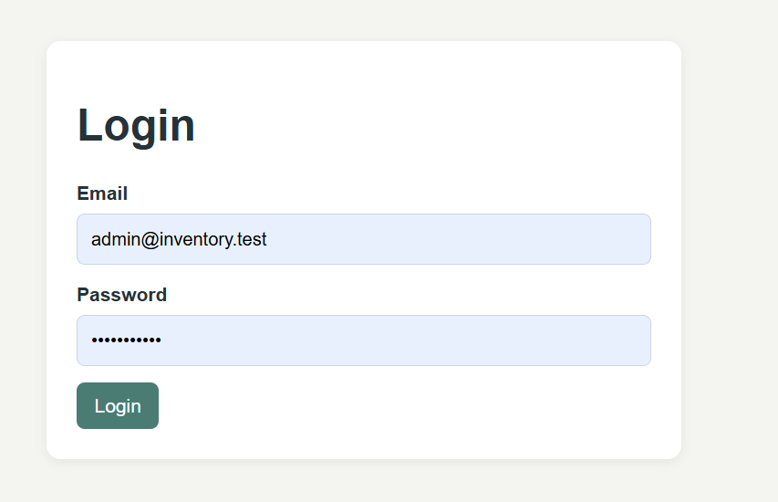
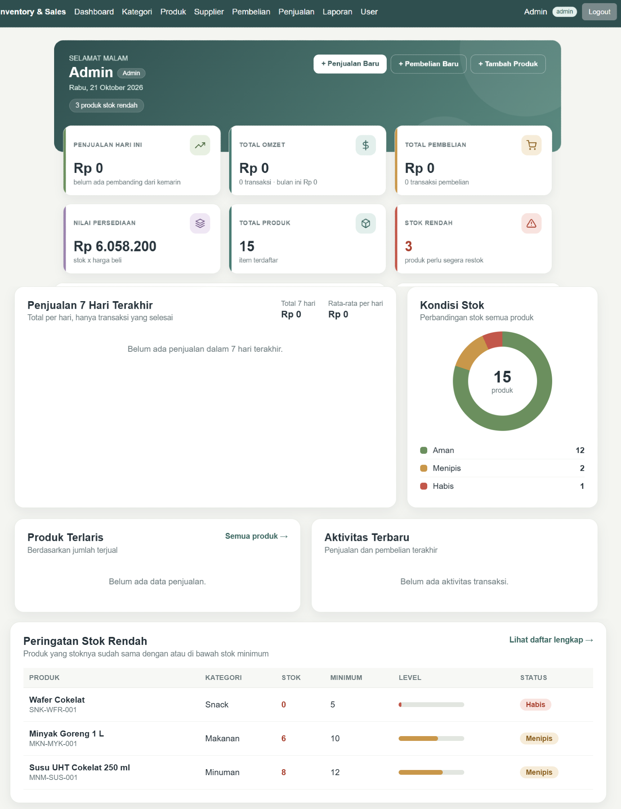
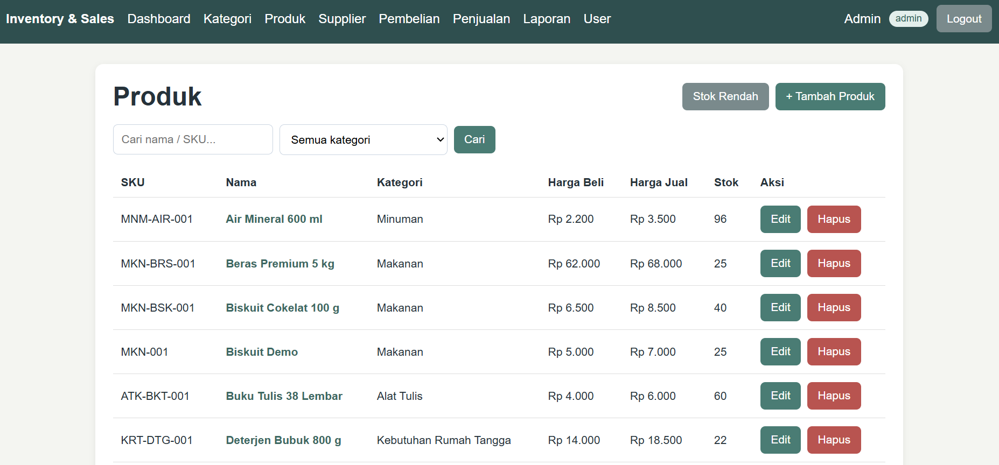
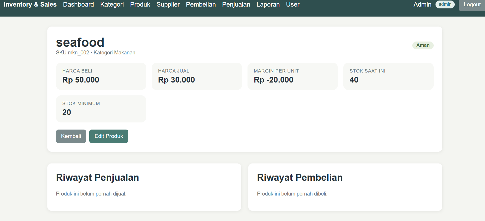
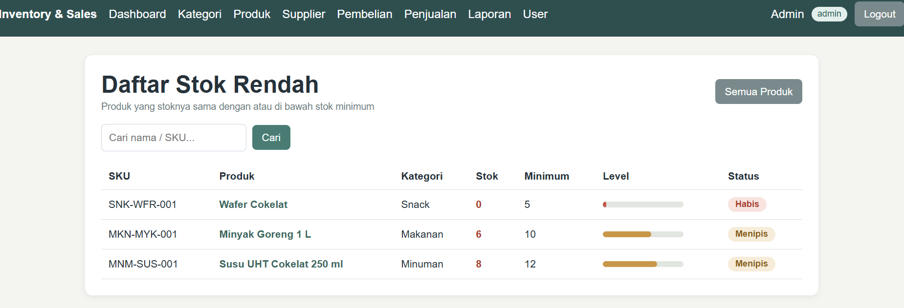
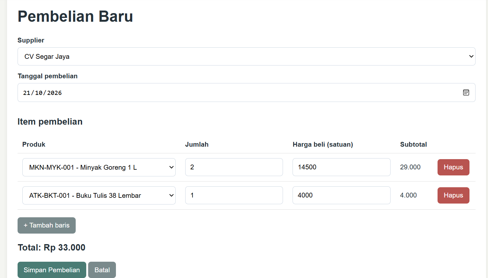
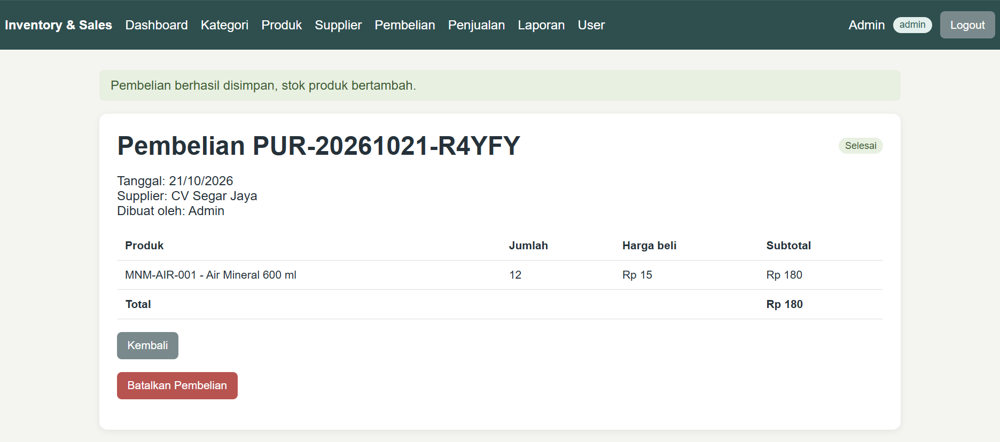
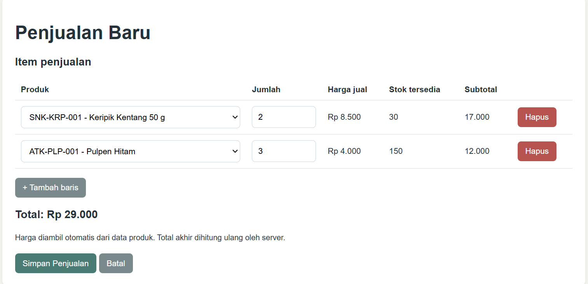
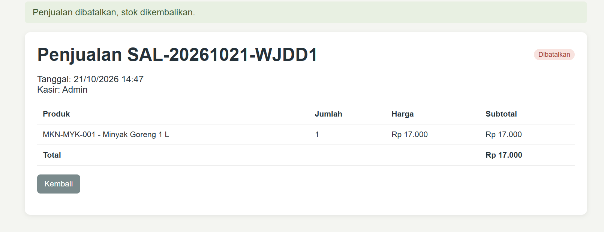
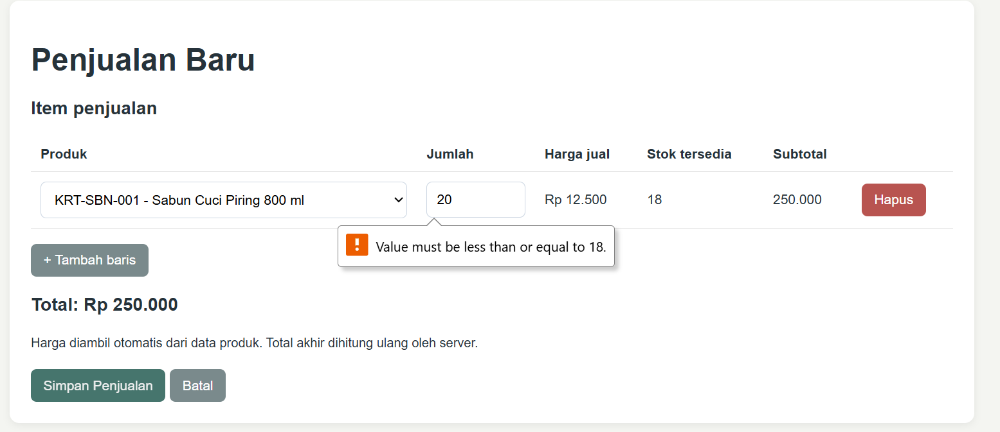
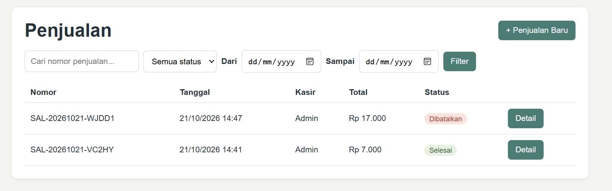
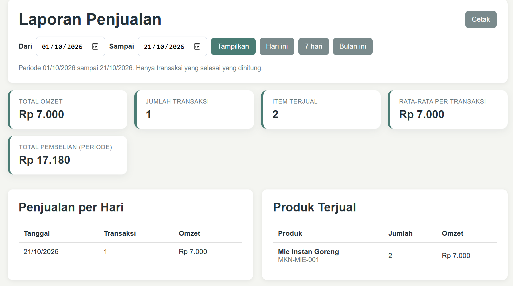
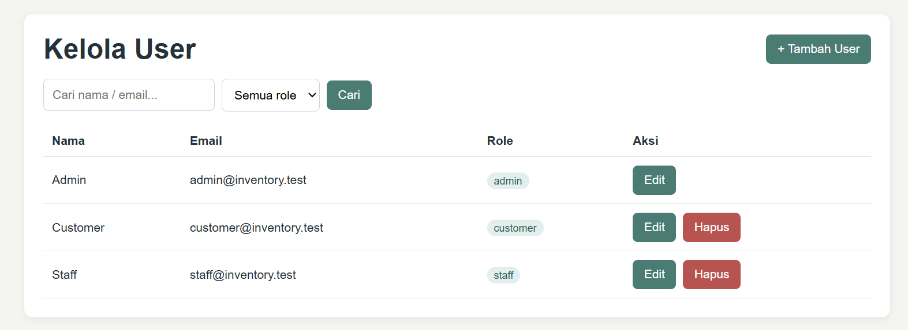
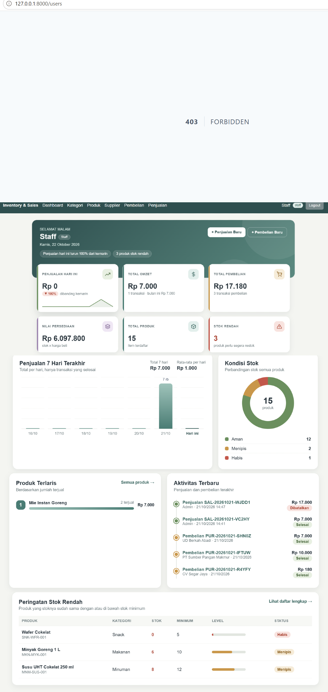
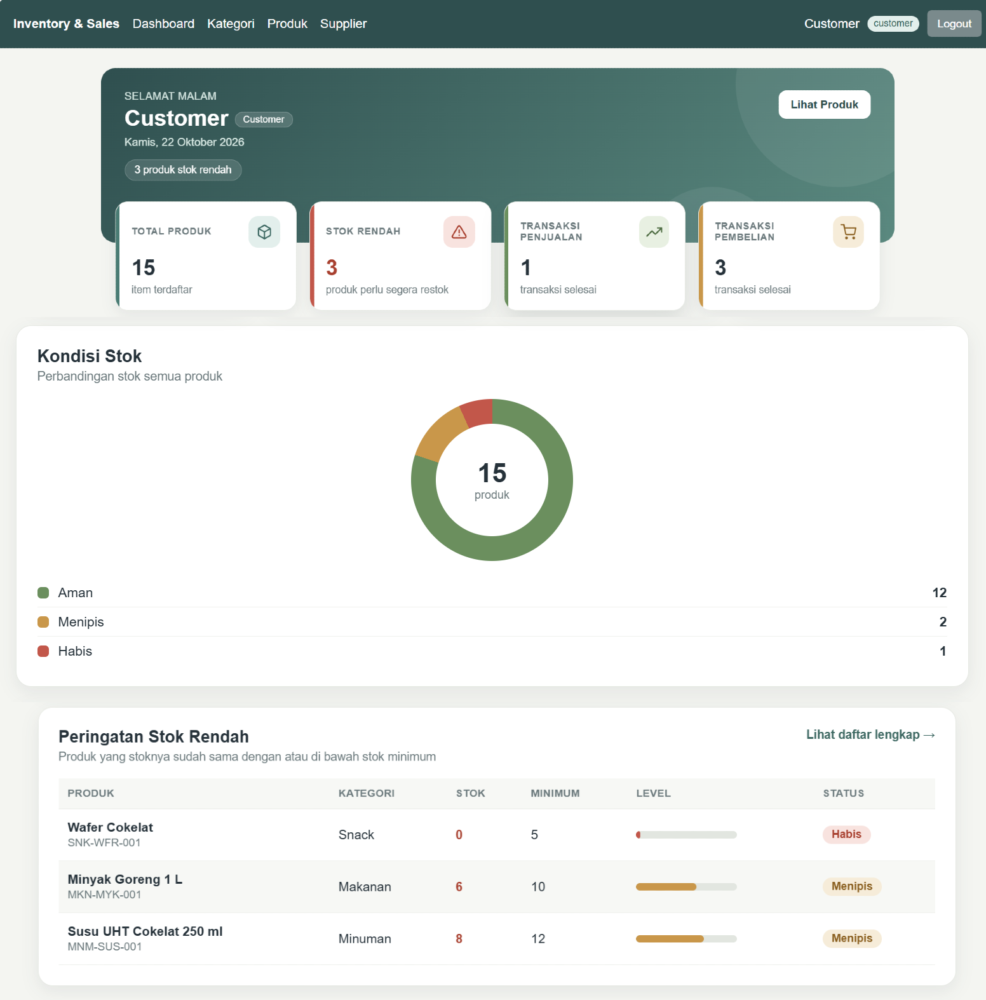
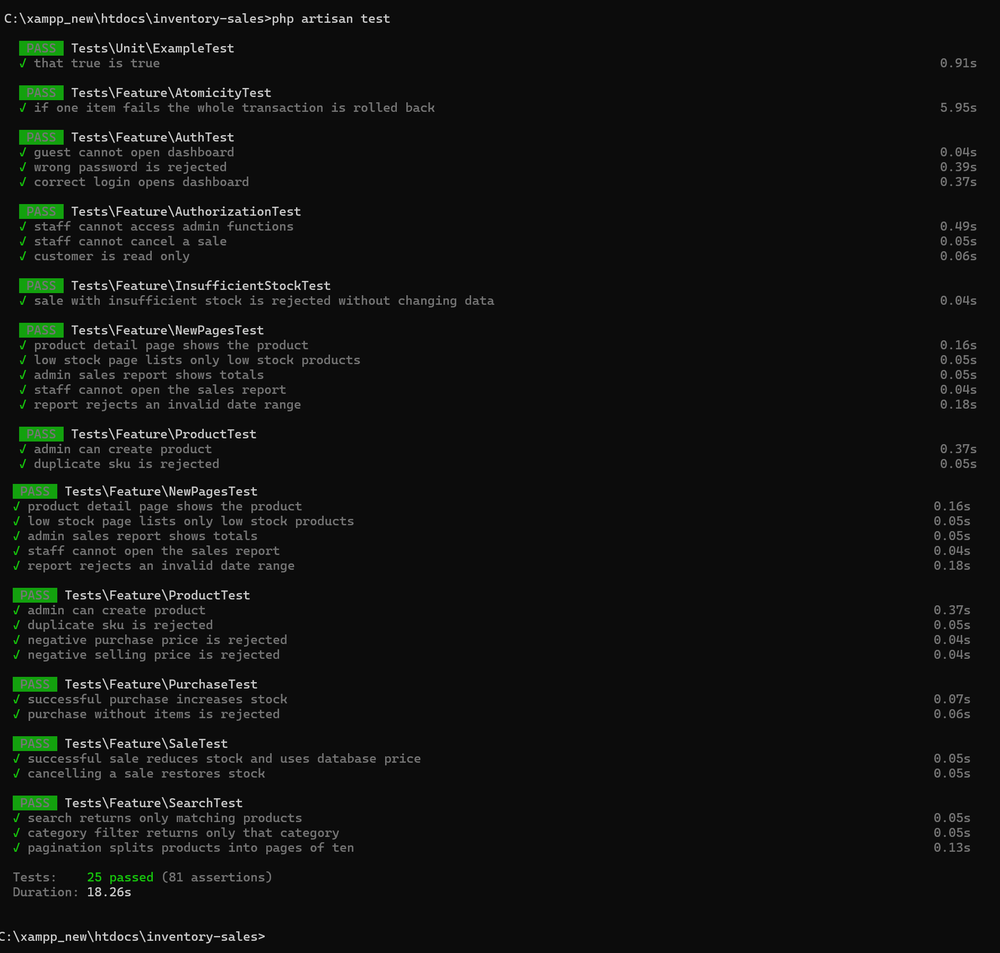

## Entity Relationship Diagram (ERD)
Berikut adalah diagram hubungan tabel utama
pada Inventory & Sales Management System.

